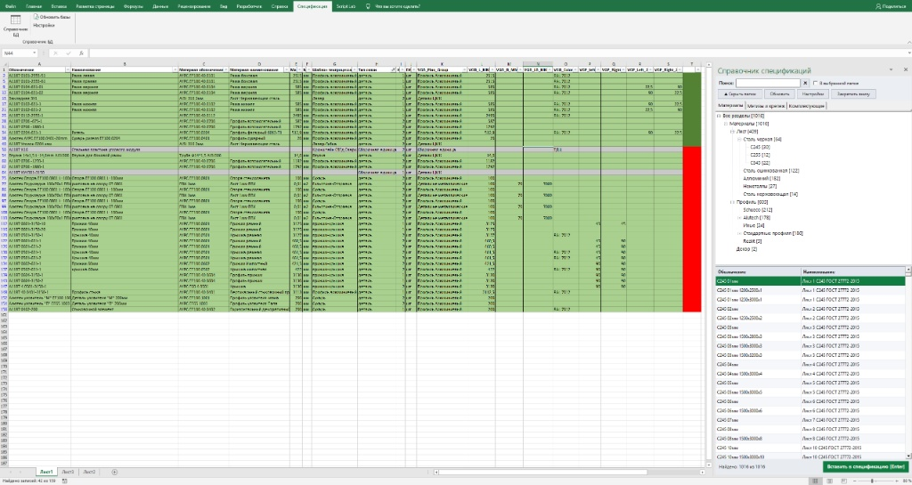
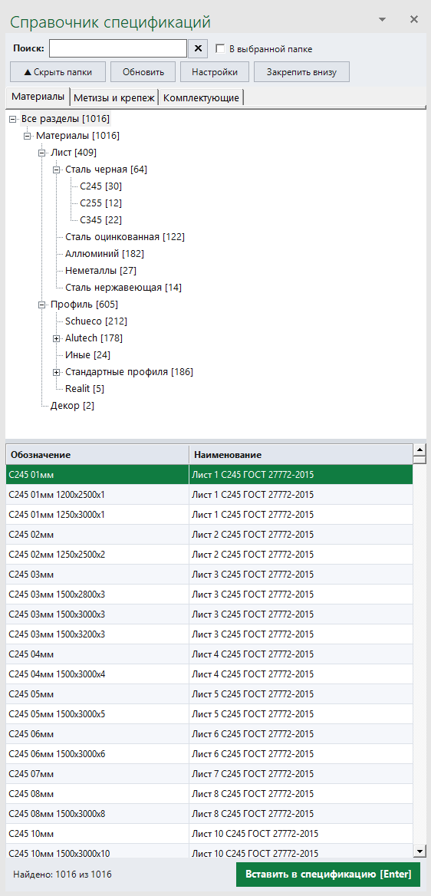

# SpecHelper — Справочник спецификаций для Microsoft Excel 2019 / 2021 / 365

> **Надстройка VSTO / COM для Microsoft Excel**  
> Автоматизация подбора и серийной вставки позиций из каталогов материалов, метизов и покупных комплектующих непосредственно в листы спецификаций и ведомостей.  
> 📄 **Полное руководство пользователя в формате Word:** [`docs/Инструкция_SpecHelper.docx`](docs/Инструкция_SpecHelper.docx)

---


*Рис. 1. Общий вид рабочего окна Excel: вкладка «Спецификация» на ленте и панель «Справочник спецификаций» справа.*

---

## ⚡ Ключевые преимущества

1. **Автономная установка без прав администратора:**  
   Развёртывание выполняется в локальный профиль пользователя (`%LOCALAPPDATA%\SpecHelper`) и реестр `HKCU`. Никаких запросов UAC, прав локального администратора, Visual Studio или установки сторонних компонентов не требуется.
2. **Поддержка 32-bit и 64-bit Microsoft Excel:**  
   Регистрация COM-интерфейсов и ActiveX автоматически дублируется в системные ветки `Classes\CLSID` и `WOW6432Node\CLSID`, обеспечивая работу с любой разрядностью Office на Windows 10/11.
3. **Мгновенная парная вставка (`Обозначение` + `Наименование`):**  
   По двойному клику или нажатию `Enter` значение столбца **Обозначение** вставляется в активную ячейку (`ActiveCell`), а **Наименование** — в соседнюю ячейку справа (`ActiveCell.Offset[0, 1]`).
4. **Штатная поддержка отмены `Ctrl + Z` (Undo):**  
   Вставка выполняется через нативную команду Office с защитой пользовательского буфера обмена. Вся история документа сохраняется, а ошибочно вставленную строку можно сразу отменить стандартным сочетанием клавиш `Ctrl + Z`.
5. **Резервный режим плавающего окна:**  
   Если в корпоративной сети строгие групповые политики безопасности блокируют встраивание панелей `CustomTaskPane`, надстройка автоматически переключается на автономное плавающее окно поверх Excel (`TopMost`) со всем набором функций.
6. **Высокая производительность и автосинхронизация:**  
   Потоковое чтение через `ExcelDataReader` загружает каталоги из десятков тысяч строк за доли секунды. Встроенный фоновый наблюдатель (`DatabaseWatcher`) автоматически обновляет данные при изменении файлов на общем диске без перезапуска Excel.

---

## 📦 Состав дистрибутива (папка `SpecHelper_РабочийПК`)

| Файл / Папка | Назначение |
| :--- | :--- |
| **`Установить_SpecHelper.bat`** (или `Установить.cmd`) | **Автоматический установщик.** Проверяет наличие библиотек, копирует файлы в профиль и регистрирует надстройку в `HKCU` для 32-bit и 64-bit Office. |
| **`Удалить_SpecHelper.bat`** (или `Удалить.cmd`) | **Скрипт удаления.** Полностью отключает надстройку и вычищает все записи из реестра Windows. |
| **`bin/`** | Скомпилированные библиотеки надстройки (`SpecHelper.dll`, `ExcelDataReader.dll`, `ExcelDataReader.DataSet.dll`, `Newtonsoft.Json.dll`, `OFFICE.DLL`, `Microsoft.Office.Interop.Excel.dll`, `extensibility.dll`). Исключены любые конфликтующие системные файлы `mscorlib.dll` / `System.*.dll`. |
| **`databases/`** | Эталонные базы данных в формате `.xlsx` (`Материалы.xlsx`, `Метизы.xlsx`, `Комплектующие.xlsx`). |
| **`Инструкция_SpecHelper.docx`** | Подробное иллюстрированное руководство пользователя по установке, настройке общих баз данных и работе в Excel. |

---

## 🚀 Установка на компьютер (занимает 30 секунд)

> [!NOTE]  
> Права администратора не требуются. Интернет не требуется. Установка производится строго в профиль текущего пользователя.

1. **Распакуйте папку установки:**  
   Скопируйте папку `SpecHelper_РабочийПК` (или весь репозиторий) на целевой компьютер (на Рабочий стол или в папку «Документы»).
2. **Закройте Microsoft Excel:**  
   Убедитесь, что все открытые документы Excel закрыты.
3. **Запустите установку:**  
   Дважды кликните по файлу **`Установить_SpecHelper.bat`** (или `Установить.cmd`).
4. **Завершение установки:**  
   Скрипт скопирует библиотеки в `%LOCALAPPDATA%\SpecHelper`, зарегистрирует компоненты и выведет сообщение `USTANOVKA USPESHNO ZAVERSHENA!`. Нажмите любую клавишу для закрытия окна.
5. **Запустите Excel:**  
   На верхней ленте появится вкладка **«Спецификация»**, а справа откроется боковая панель **«Справочник спецификаций»**.

---

## 📖 Как пользоваться надстройкой

<p align="center">
  
  <br />
  <em>Рис. 2. Боковая панель надстройки.</em>
</p>

### 1. Поиск и фильтрация позиций
- **Вкладки каталогов:** В верхней части панели переключайтесь между базами: **«Материалы»**, **«Метизы и крепеж»**, **«Комплектующие»**.
- **Дерево разделов:** Навигация по категориям любой глубины. Число в квадратных скобках показывает количество позиций в разделе (например: `Лист [409]`, `Сталь черная [64]`).
- **Мгновенный поиск:** Введите часть артикула, размера или ГОСТа (например: `С245 04` или `1500x3000`). Кнопка `✕` очищает строку, а чекбокс **«В выбранной папке»** ограничивает область поиска текущим разделом дерева.
- **Управление видом:**  
  - Кнопка **«▲ Скрыть папки»** сворачивает дерево разделов, отдавая всю высоту под таблицу.  
  - Кнопка **«Закрепить внизу» / «Закрепить справа»** переключает панель между вертикальным правым и горизонтальным нижним положением.

### 2. Вставка в спецификацию
1. Выделите в таблице спецификации Excel ячейку в столбце **«Обозначение»**.
2. В панели надстройки найдите нужную позицию и выполните вставку:
   - Дважды кликните по строке таблицы;
   - Или выберите строку стрелками и нажмите клавишу **`Enter`**;
   - Или нажмите зелёную кнопку **«Вставить в спецификацию [Enter]»**.
3. **Результат:**
   - В активную ячейку записывается **Обозначение** (например: `С245 01мм 1250x3000x1`);
   - В ячейку справа записывается **Наименование** (`Лист 1 С245 ГОСТ 27772-2015`);
   - Курсор автоматически сдвигается на строку ниже для удобного серийного ввода;
   - Если позиция выбрана ошибочно, нажмите **`Ctrl + Z`** — Excel откатит вставку обеих ячеек.

---

## 🛠️ Настройка общих баз данных и формат файлов

По умолчанию базы данных сохраняются локально в `%LOCALAPPDATA%\SpecHelper\databases`.  
Для совместной работы всего отдела с едиными каталогами:

1. Разместите файлы `.xlsx` в общей сетевой папке организации или папке синхронизации.
2. В Excel нажмите кнопку **«Настройки»** на вкладке ленты или на панели надстройки.
3. Укажите сетевые пути к файлам для каждой из трёх баз данных и сохраните настройки.

### Требования к структуре файлов баз данных (`.xlsx`)
Надстройка считывает **первый лист** книги Excel. Первая строка обязательно содержит заголовки:

| Название столбца | Назначение | Пример заполнения |
| :--- | :--- | :--- |
| **`Обозначение`** | Артикул, типоразмер, ГОСТ или код изделия | `Болт М6-6gх20.88.019 ГОСТ 7798-70` |
| **`Наименование`** | Полное текстовое наименование для спецификации | `Болт М6х20 оцинкованный кл.пр. 8.8` |
| **`Наименование папки`** | Путь в дереве каталогов через слэш `/` | `Метизы / Крепеж / Болты / ГОСТ 7798-70` |

---

## ❓ Решение возможных вопросов

* **Вкладка «Спецификация» не появилась:**  
  Откройте в Excel: `Файл` → `Параметры` → `Центр управления безопасностью` → `Параметры центра...` → `Надстройки` и снимите галочку *«Требовать, чтобы надстройки приложений были подписаны надежным издателем»*. Затем в `Параметры` → `Надстройки` → `Управление: Надстройки COM` → `Перейти...` проверьте наличие галочки напротив **SpecHelper**.
* **Панель была закрыта крестиком:**  
  Нажмите кнопку **«Справочник БД»** на ленте на вкладке «Спецификация».
* **Боковая панель заблокирована корпоративными политиками:**  
  Надстройка автоматически распознаёт блокировку `CustomTaskPane` и открывает справочник в плавающем окне поверх Excel с сохранением всех функций.
* **Полное удаление с компьютера:**  
  Закройте Excel и запустите **`Удалить_SpecHelper.bat`** (или `Удалить.cmd`).

---

## 💻 Для разработчиков

### Сборка проекта из исходного кода
Требуется .NET Framework 4.7.2 и MSBuild (Visual Studio / Build Tools):
```powershell
powershell -ExecutionPolicy Bypass -File "scripts\build.ps1"
```
Скрипт автоматически:
1. Восстанавливает зависимости NuGet;
2. Компилирует решение в конфигурации `Release`;
3. Исключает `mscorlib.dll` и системные сборки;
4. Формирует готовый автономный дистрибутив в `bin/` и `SpecHelper_РабочийПК/bin/`.

### Комплексное автоматическое тестирование
Запуск батареи из 67 автоматических тестов (проверка DLL, реестра 32/64-bit, COM-подключения, парсинга ExcelDataReader, серийной вставки, отмены по `Ctrl+Z`, работы защищённых листов, фонового автообновления и чистого удаления):
```powershell
powershell -ExecutionPolicy Bypass -File "scripts\full_verification.ps1"
```

### 🔄 Система автообновлений
Надстройка оснащена встроенным механизмом фонового обновления:
1. При старте Excel надстройка в отдельном потоке опрашивает `version.json` в репозитории `https://github.com/pururuall/SpecHelper`.
2. Если интернета нет или GitHub недоступен, проверка завершается тихо за 5 секунд, не мешая работе пользователя.
3. Если на GitHub опубликован релиз с более новой версией (`AssemblyFileVersion`), пользователю предлагается обновиться: закрывается Excel, скрипт `apply_update.bat` распаковывает свежие `.dll` в `%LOCALAPPDATA%\SpecHelper` и перезапускает Excel.
4. **Реестр Windows трогать не нужно:** базовый `AssemblyVersion` остаётся `1.0.0.0` для неизменности COM-привязки в `HKCU`.
